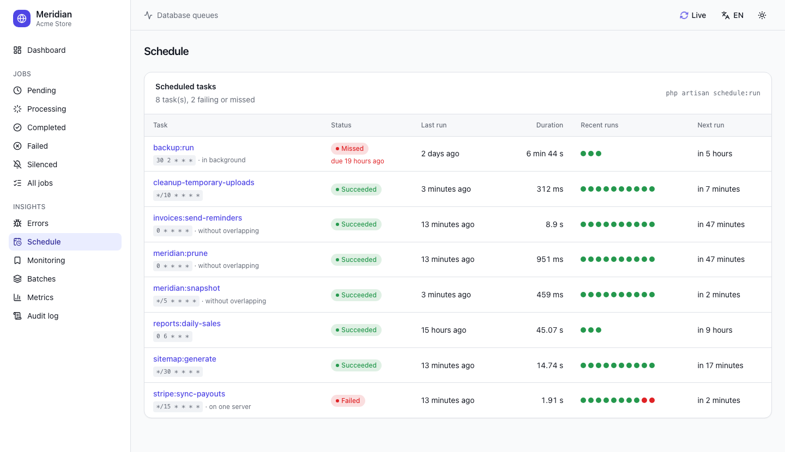

<p align="center">
    <picture>
        <source media="(prefers-color-scheme: dark)" srcset="art/logo-dark.svg">
        
    </picture>
</p>

<p align="center">
    <a href="https://github.com/Iso-Doss/laravel-meridian/actions/workflows/run-tests.yml?query=branch%3Amain"></a>
    <a href="https://github.com/Iso-Doss/laravel-meridian/actions/workflows/phpstan.yml?query=branch%3Amain"></a>
    <a href="https://packagist.org/packages/iso-doss/laravel-meridian"></a>
    <a href="https://packagist.org/packages/iso-doss/laravel-meridian"></a>
    <a href="https://packagist.org/packages/iso-doss/laravel-meridian"></a>
</p>

<p align="center"><b><a href="https://iso-doss.github.io/laravel-meridian/">📖 Read the documentation</a></b></p>

## Introduction

Meridian gives the Laravel **database** queue driver what [Laravel Horizon](https://laravel.com/docs/horizon) gives Redis: a beautiful dashboard and code-driven configuration. Monitor the throughput, runtime, wait time and failures of your jobs, search them by tag, retry them in one click, and follow your batches and workers live.

All of your worker configuration lives in a single, simple configuration file. `php artisan meridian` starts and supervises your `queue:work` processes and balances them between your queues according to their workload, exactly like Horizon, so your whole team can scale the workers from source control.

**What sets Meridian apart**

- **Nothing to change in your jobs.** Every job is recorded from Laravel's own queue events: no trait, no interface, no base class. Batches, `Queue::bulk()` and `pushRaw()` jobs included.
- **A real supervisor, not only a dashboard.** `php artisan meridian` starts, restarts and auto-scales your `queue:work` processes (`auto`, `simple` or `log` strategies), with per-supervisor pause and resume, memory limit and graceful termination.
- **Horizon's features on the database driver**, without Redis and without depending on Horizon's internals: monitored tags, retry history, silenced jobs, metrics, long-wait notifications by e-mail, Slack or SMS.
- **Beyond Horizon**: failed jobs grouped by cause and retried with corrected data, the origin of every job (request, command, task or parent job), scheduled tasks monitoring, alerts on failure rates, missing workers and long jobs, job progress, redaction of the sensitive data, read-only access and an audit log.
- **Fits your tools**: Prometheus / OpenTelemetry metrics for Grafana or Datadog, a Laravel Pulse card, a Filament plugin, and `meridian:top` in the terminal.
- **Two interfaces**: a modern React / Inertia / shadcn/ui one, or a lightweight Blade one, in light, dark or system theme, in **English, French, Spanish, Portuguese, German and Arabic** (right to left).
- **Nothing to build.** The compiled assets ship with the package: your application needs neither Node nor an Inertia setup, and never conflicts with its own.
- **Production-ready**: works under a strict, nonce-based **Content-Security-Policy**, on MySQL, MariaDB, PostgreSQL and SQLite, with Laravel 12 and 13.

<p align="center">
    <picture>
        <source media="(prefers-color-scheme: dark)" srcset="art/dashboard-dark.png">
        
    </picture>
</p>

- [Why Meridian?](#why-meridian)
  - [Meridian and the other packages](#meridian-and-the-other-packages)
- [Screenshots](#screenshots)
- [Installation](#installation)
  - [Primary keys](#primary-keys)
- [Configuration](#configuration)
  - [Environments and supervisors](#environments-and-supervisors)
  - [Balancing strategies](#balancing-strategies)
  - [Worker options](#worker-options)
  - [Silenced jobs](#silenced-jobs)
- [Running Meridian](#running-meridian)
  - [Deploying Meridian](#deploying-meridian)
- [The dashboard](#the-dashboard)
  - [Dashboard authorization](#dashboard-authorization)
  - [Read-only access](#read-only-access)
  - [Audit log](#audit-log)
  - [Job origin](#job-origin)
  - [Sensitive data](#sensitive-data)
  - [Interfaces, themes and languages](#interfaces-themes-and-languages)
  - [Content-Security-Policy](#content-security-policy)
  - [Export](#export)
  - [JSON API](#json-api)
- [Tags](#tags)
  - [Monitored tags](#monitored-tags)
- [Errors](#errors)
  - [Retry with corrected data](#retry-with-corrected-data)
- [Job progress](#job-progress)
  - [Cancelling a running job](#cancelling-a-running-job)
- [Scheduled tasks](#scheduled-tasks)
- [Notifications](#notifications)
  - [Alerts](#alerts)
- [Metrics](#metrics)
  - [Prometheus and OpenTelemetry](#prometheus-and-opentelemetry)
- [Laravel Pulse and Filament](#laravel-pulse-and-filament)
- [Retention](#retention)
- [How it works](#how-it-works)
- [Upgrading](#upgrading)
- [Contributing](#contributing)

## Why Meridian?

Horizon only works with Redis. If your application runs its queues on the `database` driver, you usually have no visibility on what runs in the background: the `jobs` table only holds pending jobs, and a job leaves no trace once it is processed. Meridian records the whole life of every job and brings the Horizon experience to the database driver:

- **Dashboard**: jobs per minute, jobs of the past hour, failures, pending and delayed jobs, max wait time, slowest and busiest queues, throughput chart, workload per queue, supervisors and workers.
- **Job history**: pending, processing, completed and failed jobs, with their tags, readable data (the properties of the job), payload, exception, attempts, wait time and runtime.
- **Errors**: the failed jobs grouped by cause (same exception thrown at the same line), with their number, first and last occurrence; retry a whole group in one click.
- **Monitored tags**: watch a customer, an order or any tag; its jobs are listed together and kept longer.
- **Job progress**: a job reports `$this->progress(42)` and the dashboard shows a progress bar and the estimated remaining time.
- **Scheduled tasks**: every run of `schedule:run` with its status, duration and exception, and the tasks that failed or did not run when due.
- **Search** by job class, tag (`App\Models\User:42`, or anything returned by a `tags()` method) or UUID.
- **Actions**: retry one failed job, or all the failed jobs matching the filters of the list, with the history of each retry; cancel a pending or a running job; retry the failed jobs of a batch.
- **Batches**: progress of your `Bus::batch()` batches and of their jobs.
- **Metrics**: per job and per queue (processed, failure rate, average, p95, p99 and max runtime, average wait, trend against the previous period), a heatmap of the jobs per hour, and a history of snapshots.
- **Export** of the jobs and errors as CSV or JSON.
- **Workers**: every `queue:work` process reports a heartbeat (status, memory, jobs processed), even without Meridian's supervisor.
- **Supervisors**: `php artisan meridian` balances processes between queues (`auto`, `simple` or no balancing), with `meridian:pause`, `meridian:continue` and `meridian:terminate`, for all supervisors or one at a time.
- **Alerts** by e-mail, Slack, SMS or webhooks (Discord, Teams, Google Chat, any URL) when a queue waits too long, fails too often, has no worker, or when a job runs for too long.
- **Read-only access and audit log**: choose who can retry, delete or cancel jobs, and see who did what, and when.
- **A modern interface**: React, Inertia and shadcn/ui, light, dark and system themes, six languages, live refresh. Its compiled assets ship with the package: your application needs neither Node, React nor an Inertia setup of its own.

### Meridian and the other packages

Other packages cover part of this ground. Meridian is built to cover all of it in one place:

| | Meridian | Job monitors | Horizon on a database | Admin panel plugins |
| --- | --- | --- | --- | --- |
| Records every job without changing it | ✅ | Often needs a trait on each job | ✅ | Only pending and failed jobs |
| Supervises and auto-scales the workers | ✅ | ❌ | ✅ | ❌ |
| Monitored tags, retry history, metrics | ✅ | Partly | ✅ | ❌ |
| Errors grouped by cause, failure alerts, read-only access, audit log | ✅ | Partly | ❌ | ❌ |
| Scheduled tasks monitoring, retry with corrected data | ✅ | ❌ | ❌ | ❌ |
| Prometheus metrics, Pulse card, Filament plugin | ✅ | ❌ | ❌ | Filament only |
| Independent from Horizon's internals | ✅ | ✅ | ❌ (rebinds Horizon's services) | ✅ |
| Standalone dashboard, no admin panel required | ✅ | ✅ | ✅ | ❌ (Filament, Nova…) |
| Strict CSP, six languages, Blade or React | ✅ | ❌ | ❌ | Depends on the panel |

Choose Meridian if you want the full Horizon experience on the `database` driver, from the dashboard to the supervision of your workers, without Redis and without adding anything to your jobs.

## Screenshots

<table>
    <tr>
        <td width="50%">
            <picture>
                <source media="(prefers-color-scheme: dark)" srcset="art/jobs-dark.png">
                
            </picture>
            <p align="center"><b>Jobs</b>: by status, with the progress of the running ones, filtered by queue or tag</p>
        </td>
        <td width="50%">
            <picture>
                <source media="(prefers-color-scheme: dark)" srcset="art/job-dark.png">
                
            </picture>
            <p align="center"><b>Job details</b>: exception, same errors, retry history, readable data</p>
        </td>
    </tr>
    <tr>
        <td width="50%">
            <picture>
                <source media="(prefers-color-scheme: dark)" srcset="art/errors-dark.png">
                
            </picture>
            <p align="center"><b>Errors</b>: failed jobs grouped by cause, retried in one click</p>
        </td>
        <td width="50%">
            <picture>
                <source media="(prefers-color-scheme: dark)" srcset="art/schedule-dark.png">
                
            </picture>
            <p align="center"><b>Schedule</b>: every run of your scheduled tasks, failed and missed ones flagged</p>
        </td>
    </tr>
    <tr>
        <td width="50%">
            <picture>
                <source media="(prefers-color-scheme: dark)" srcset="art/monitoring-dark.png">
                
            </picture>
            <p align="center"><b>Monitoring</b>: watch tags, keep their jobs longer</p>
        </td>
        <td width="50%">
            <picture>
                <source media="(prefers-color-scheme: dark)" srcset="art/batches-dark.png">
                
            </picture>
            <p align="center"><b>Batches</b>: progress, pending and failed jobs</p>
        </td>
    </tr>
    <tr>
        <td width="50%">
            <picture>
                <source media="(prefers-color-scheme: dark)" srcset="art/metrics-dark.png">
                
            </picture>
            <p align="center"><b>Metrics</b>: per job or per queue, over 1 hour to 7 days</p>
        </td>
        <td width="50%">
            <picture>
                <source media="(prefers-color-scheme: dark)" srcset="art/audit-dark.png">
                
            </picture>
            <p align="center"><b>Audit log</b>: who did what, and when</p>
        </td>
    </tr>
    <tr>
        <td width="50%">
            <picture>
                <source media="(prefers-color-scheme: dark)" srcset="art/blade-dark.png">
                
            </picture>
            <p align="center"><b>Blade interface</b>: the same pages, server-rendered (<code>MERIDIAN_UI=blade</code>)</p>
        </td>
        <td width="50%">
            
            <p align="center"><b>Terminal</b>: <code>php artisan meridian:top</code>, live</p>
        </td>
    </tr>
</table>

The screenshots follow the theme of your GitHub account: switch it to see the other one.

## Installation

Meridian requires PHP 8.3+, Laravel 12 or 13, and `inertiajs/inertia-laravel` v3 (installed with the package).

```bash
composer require iso-doss/laravel-meridian
php artisan meridian:install
```

The install command publishes `config/meridian.php`, the migration and `App\Providers\MeridianServiceProvider` (registered in `bootstrap/providers.php`), then offers to run the migrations.

If your application does not have them yet, create the tables of the database queue driver:

```bash
php artisan make:queue-table
php artisan make:queue-failed-table
php artisan make:queue-batches-table
php artisan migrate
```

Then check the installation:

```bash
php artisan meridian:doctor
```

It checks the database, the migrations, the queue tables, the supervisors, the scheduler, the redaction of the payloads and the access to the dashboard, and tells how to fix each problem (it exits with an error code when something must be fixed, for a deployment script).

Meridian registers `meridian:snapshot` (every five minutes) and `meridian:prune` (hourly) in the scheduler: make sure it runs (`php artisan schedule:work` locally, a cron entry in production), or disable this with `meridian.schedule = false` and schedule them yourself.

### Primary keys

Meridian's tables use UUID primary keys by default (UUIDv7, which grow with time, so sorting by `id` keeps the insertion order). To use ULIDs or auto-incrementing integers instead, set the type **before running the migrations**:

```ini
MERIDIAN_PRIMARY_KEY=uuid   # default; or "ulid", or "id" for auto-incrementing integers
```

The migrations check `Schema::hasTable()` and `Schema::hasColumn()` before creating anything, so running them again is harmless. Tables that already exist keep their key type: Meridian reads the type of each table's `id` column and writes to it accordingly, so an application installed before this option keeps its integer keys without any change.

## Configuration

After installing Meridian, its configuration lives in `config/meridian.php`. Each option is documented in the file itself.

### Environments and supervisors

The `environments` option lists, for each environment of your application, the supervisors to run. A supervisor manages a group of worker processes processing one or more queues. The supervisors of the current environment (`APP_ENV`) are started; a `'*'` environment is used when none matches.

```php
'environments' => [
    'production' => [
        'supervisor-1' => [
            'connection' => 'database',
            'queue' => ['default', 'emails', 'images'],
            'balance' => 'auto',
            'minProcesses' => 1,
            'maxProcesses' => 10,
            'balanceMaxShift' => 1,
            'balanceCooldown' => 3,
            'tries' => 3,
        ],

        'reports' => [
            'connection' => 'database',
            'queue' => ['reports'],
            'balance' => 'simple',
            'maxProcesses' => 2,
            'timeout' => 300,
        ],
    ],

    'local' => [
        'supervisor-1' => [
            'maxProcesses' => 3,
        ],
    ],
],
```

The `defaults` option holds the values shared by every supervisor of the same name, merged with the values of the environment.

### Balancing strategies

| `balance` | Behaviour |
| --- | --- |
| `auto` (default) | Each queue gets its own pool of processes; Meridian moves processes towards the queues with the most work, between `minProcesses` per queue and `maxProcesses` in total. With `autoScalingStrategy: time` (default) the work of a queue is its pending jobs × their average runtime, with `size` only its number of pending jobs, and with `log` the logarithm of that number, so that one huge queue does not take every process. `balanceMaxShift` processes are added or removed every `balanceCooldown` seconds. |
| `simple` | `maxProcesses` is split evenly between the queues. |
| `false` | `maxProcesses` workers process the queues in the order they are listed, like `queue:work --queue=high,default`. |

Like with Horizon, the order of the queues does not set priorities with `auto` balancing: give a resource-heavy queue its own supervisor with a low `maxProcesses`.

### Worker options

| Option | Default | `queue:work` option |
| --- | --- | --- |
| `tries` | `1` | `--tries` |
| `timeout` | `60` | `--timeout` (keep it a few seconds below `retry_after`) |
| `backoff` | `0` | `--backoff` |
| `memory` | `128` | `--memory` |
| `sleep` | `3` | `--sleep` |
| `maxJobs` | `0` | `--max-jobs` |
| `maxTime` | `0` | `--max-time` |
| `rest` | `0` | `--rest` |
| `nice` | `0` | runs the workers with `nice -n` |
| `force` | `false` | `--force` (process jobs in maintenance mode) |

### Silenced jobs

Completed jobs listed in the `silenced` option, implementing `IsoDoss\Meridian\Contracts\Silenced`, or carrying a tag of the `silenced_tags` option leave the « Completed » list for the « Silenced » one, like with Horizon. They still count in the metrics and are pruned like the completed jobs. Their failures are always listed with the other failures.

```php
'silenced' => [
    App\Jobs\PingHealthCheck::class,
],

'silenced_tags' => [
    'notifications',
],
```

## Running Meridian

You have two options:

1. **Keep your workers.** Run `php artisan queue:work database ...` with Supervisor or systemd as usual: jobs, metrics and workers show up in the dashboard.
2. **Let Meridian supervise them**, like Horizon: run one long-lived process and Meridian starts, restarts and balances the `queue:work` processes of the current environment.

```bash
php artisan meridian
```

| Command | Description |
| --- | --- |
| `meridian` | Start the master supervisor |
| `meridian:status` | Show the status, the supervisors and the workload |
| `meridian:pause` / `meridian:continue` | Pause or resume the workers (`--all` for every host) |
| `meridian:pause-supervisor {name}` / `meridian:continue-supervisor {name}` | Pause or resume the workers of one supervisor (`--all` for every host) |
| `meridian:supervisors` | List the running supervisors |
| `meridian:supervisor-status {name}` | Show the status of a supervisor |
| `meridian:terminate` | Finish the running jobs, then stop the master supervisor (`--all` for every host) |
| `meridian:list` | List the machines running Meridian (the master supervisors) |
| `meridian:purge` | Terminate the workers left by a master that was killed, and forget the dead processes of this machine (`--signal=SIGTERM`) |
| `meridian:snapshot` | Store a metrics snapshot, import the jobs pushed without event, check the wait times |
| `meridian:prune` | Delete old completed and failed jobs, metrics and stale heartbeats |
| `meridian:doctor` | Check the installation: migrations, queue tables, supervisors, scheduler, redaction and dashboard access, with how to fix each problem |
| `meridian:forget {uuid}` / `meridian:forget --all` | Delete a failed job, or all of them, from Meridian and from the failed jobs table |
| `meridian:clear {connection?} --queue=` | Delete the jobs waiting on a queue (asks for confirmation in production, `--force` to skip it) |
| `meridian:clear-metrics` | Delete every metrics snapshot |
| `meridian:listen` | Local development: run Meridian and restart it whenever a PHP file of the application changes |
| `meridian:top` | Live view of the queues, running jobs, supervisors, errors and failing scheduled tasks in the terminal (`--interval=2`, `--once`) |

`php artisan meridian` requires the `pcntl` and `posix` extensions. When its memory exceeds `memory_limit` (64 MB by default, `0` to disable), it finishes the running jobs and exits with the code 12, so that your process monitor starts it again with fresh memory.

In local development, `php artisan meridian:listen` runs Meridian and restarts it whenever a PHP file of the directories listed in the `watch` option changes (`app`, `config`, `routes`…). Unlike `horizon:listen`, it needs neither Node nor any npm package: it polls the files every second (`--poll=` to change it).

### Deploying Meridian

Keep `php artisan meridian` running with a process monitor such as Supervisor, and run `php artisan meridian:terminate` during each deployment: the running jobs finish, Meridian exits, and the process monitor restarts it with your new code.

```ini
[program:meridian]
process_name=%(program_name)s
command=php /var/www/app/artisan meridian
autostart=true
autorestart=true
user=forge
redirect_stderr=true
stdout_logfile=/var/www/app/storage/logs/meridian.log
stopwaitsecs=3600
```

`stopwaitsecs` must be longer than your longest job.

**Fast termination**: by default, `meridian:terminate` waits for the running jobs to finish before the master exits, which may delay your deployment. Like Horizon, set `'fast_termination' => true` to make the master exit right away: its workers finish their current job on their own, while your process monitor already starts the new master with your new code.

If a master was killed without terminating its workers (`kill -9`, out of memory...), `php artisan meridian:purge` terminates the workers it left behind.

## The dashboard

The dashboard is available at `/meridian`. Its pages refresh themselves every `meridian.poll` seconds (switch « Live » in the header).

### Dashboard authorization

In the `local` environment everybody can open the dashboard. In the other environments, access is granted by the `viewMeridian` gate of `app/Providers/MeridianServiceProvider.php`:

```php
protected function gate(): void
{
    Gate::define('viewMeridian', function ($user = null) {
        return in_array(optional($user)->email, [
            'taylor@example.com',
        ]);
    });
}
```

You may also call `Meridian::auth(fn (Request $request) => ...)` directly. The prefix, domain and middleware of the dashboard and of its API are configured in the `route` option (`MERIDIAN_PREFIX`, `MERIDIAN_API_PREFIX`, `MERIDIAN_DOMAIN`); the authorization middleware is always added on top of them.

### Read-only access

By default, everybody who can open the dashboard can also retry, delete and cancel jobs, and monitor tags. To give some people a read-only access, define the `manageMeridian` gate in `app/Providers/MeridianServiceProvider.php`:

```php
protected function gate(): void
{
    Gate::define('viewMeridian', fn ($user = null) => in_array(optional($user)->email, [
        'taylor@example.com',
        'support@example.com',
    ]));

    // Only Taylor can act on the jobs, the support team can only look.
    Gate::define('manageMeridian', fn ($user = null) => in_array(optional($user)->email, [
        'taylor@example.com',
    ]));
}
```

or call `Meridian::manage(fn (Request $request) => ...)`. The read-only users browse every page, but the buttons that act on the jobs are hidden and their requests are refused (403). The page header shows « Read only ».

### Audit log

The « Audit log » page lists who retried, deleted or cancelled a job, retried a batch or a group of failed jobs, monitored a tag, and who paused, resumed, terminated or cleared Meridian from the command line, with the date, the IP address and the details of each action. Users are named by their `email`, else their `name`, else their identifier; Artisan commands appear as « Console ». The entries are kept `trim.audit` minutes (30 days by default) and are also available as JSON (`GET /meridian/api/audit`).

### Job origin

Each job records who dispatched it: the HTTP request (method, path and route name, never the query string, which may carry tokens) and the signed-in user, the artisan command (its name only, not its options), the scheduled task, or the job that dispatched it. The job page shows it under « Dispatched by », with a link to the parent job and its status, and lists the jobs a job dispatched (« Dispatched jobs »), to follow a chain of jobs back to the request that started it. Nothing to change in your code; the jobs recorded before the migration of v1.12.0 have no origin.

### Sensitive data

Before storing a payload, Meridian replaces with `[redacted]` the values of the keys and job properties whose name matches the `redact` option: passwords, secrets, tokens, API keys, `authorization`, card numbers and CVV by default. Case, `_` and `-` are ignored (`api_key` matches `apiKey`) and `*` is a wildcard.

```php
'redact' => ['*password*', '*secret*', '*token*', '*api_key*', 'authorization', 'card_number', 'cvv', 'cvc', 'iban'],
```

The serialized job is rewritten without being unserialized: no code of your application runs. Encrypted jobs (`ShouldBeEncrypted`) are stored as they are, since they are already unreadable. The jobs keep their real values: retrying a job or editing its data starts from the original payload of the failed jobs table, and the redacted fields are never shown nor editable. A job whose payload was redacted and which is no longer in the failed jobs table cannot be retried from Meridian. Set `'redact' => []` to store the payloads untouched, or `store_payload` to `false` to store none.

### Interfaces, themes and languages

Two interfaces ship with Meridian:

- **Inertia** (default): React, Inertia and shadcn/ui. It has its own root view, Inertia middleware and asset version: your application's Inertia setup (shared props, SSR, root view) is never involved, even when it uses Inertia too.
- **Blade**: a lightweight server-rendered interface, with the same pages.

Both offer a light, dark or system theme (kept in the browser) and are translated in English, French, Spanish, Portuguese, German and Arabic (written from right to left): the language follows the application locale and can be changed from the interface (kept in a cookie). Restrict the offered languages with the `locales` option.

To use the Blade interface, set in your `.env`:

```dotenv
MERIDIAN_UI=blade
```

or `'ui' => 'blade'` in a published `config/meridian.php` (republish it with `php artisan vendor:publish --tag=meridian-config --force` to get the keys added since your version), then `php artisan config:clear` if the configuration is cached. Both interfaces share the same URLs, route names, actions and JSON API.

### Export

The lists of jobs and the errors can be downloaded as **CSV** (for a spreadsheet) or **JSON**, with the filters of the list (status, queue, search, tag, error): « Export » at the top of the page, or `GET /meridian/jobs/export?status=failed&format=csv` and `GET /meridian/errors/export?format=json`. The exports are streamed, whatever their size, and the CSV cells that a spreadsheet would run as formulas are neutralized.

### Content-Security-Policy

Meridian works under a strict, nonce-based CSP such as `script-src 'nonce-…' 'strict-dynamic' 'self'`: when your application sets a nonce with `Vite::useCspNonce()`, Meridian puts it on its scripts and styles and passes it to Inertia. There is nothing to configure, and no need to exempt Meridian's routes from your policy.

### JSON API

The dashboard data is also available as JSON, behind the same authorization: `GET /meridian/api/stats`, `/meridian/api/workload`, `/meridian/api/jobs/{status?}?search=&queue=` and `/meridian/api/jobs/{uuid}`.

## Tags

Meridian tags jobs, mailables, broadcast events, notifications and queued event listeners like Horizon does. The Eloquent models held by a job are tagged automatically: a `RenderVideo` job holding the `App\Models\Video` with the id `1` gets the `App\Models\Video:1` tag. To tag a job yourself, give it a `tags` method:

```php
class RenderVideo implements ShouldQueue
{
    public function tags(): array
    {
        return ['render', 'video:'.$this->video->id];
    }
}
```

Click a tag anywhere in the dashboard to list every job carrying it. The page of a retried job lists every retry with its outcome, runtime and exception. On the failed jobs page, « Retry all » pushes back every failed job matching the current filters (queue, search): retry all the failed jobs of a queue, or of a customer by searching its tag.

### Monitored tags

Like Horizon, the « Monitoring » page lets you watch tags: add `App\Models\User:42` or `customer:42` and its jobs are listed together, with their number of pending and failed jobs. The jobs carrying a monitored tag are kept `trim.monitored` minutes (7 days by default) instead of `trim.completed`.

Monitored tags are stored in the `meridian_monitored_tags` table. When upgrading from a version older than 1.4.0 (monitored tags), 1.5.0 (retry history), 1.7.0 (errors, job progress, audit log) or 1.8.0 (scheduled tasks), publish and run the new migrations:

```bash
php artisan vendor:publish --tag=meridian-migrations
php artisan migrate
```

## Errors

The « Errors » page groups the failed jobs by cause: the same exception class thrown at the same line, whatever its message (`User 12 not found` and `User 57 not found` are one error). Each group shows the exception, its message and location, the jobs and queues it affects, its number of occurrences and when it was first and last seen. Open a group to list its jobs, or « Retry all » to push them all back onto their queue once the bug is fixed. The page of a failed job links to the other jobs failing with the same error. The groups are also available as JSON (`GET /meridian/api/errors`).

### Retry with corrected data

When a job failed because of an invalid value (a wrong e-mail address, an outdated identifier...), « Edit and retry » on its page lets you change its data and push it back onto its queue. Strings, numbers, booleans and arrays can be changed; models, enums, dates and other objects are kept as they are, and so are the queue settings of the job (`tries`, `timeout`...). Encrypted jobs stay encrypted. Every change is recorded in the audit log.

Changing the data of a job is sensitive, so only the people allowed by the `editMeridianJobs` gate can (and only among those who can act on the jobs). Without the gate, it is only available in the `local` environment:

```php
Gate::define('editMeridianJobs', fn ($user = null) => in_array(optional($user)->email, [
    'taylor@example.com',
]));
```

or `Meridian::editJobs(fn (Request $request) => ...)`.

## Job progress

Long jobs can report their progress with the `IsoDoss\Meridian\Concerns\TracksProgress` trait: the dashboard shows a progress bar, the estimated remaining time and an optional message while they run.

```php
use IsoDoss\Meridian\Concerns\TracksProgress;

class ImportCustomers implements ShouldQueue
{
    use Dispatchable, InteractsWithQueue, Queueable, TracksProgress;

    public function handle(): void
    {
        foreach ($this->rows as $index => $row) {
            // ...

            $this->progressOf($index + 1, count($this->rows), ($index + 1).' customers imported');
        }
    }
}
```

`$this->progress(42)` takes a percentage, `$this->progressOf($done, $total)` computes it. Meridian only writes when the percentage or the message changes, so you may call them in a tight loop.

### Cancelling a running job

« Cancel job » also works on a running job. The job is asked to stop:

- a job using `TracksProgress` stops cleanly when it checks `$this->cancelled()` (one query per second at most), then Meridian forgets it:

  ```php
  foreach ($this->rows as $row) {
      if ($this->cancelled()) {
          return;
      }

      // ...
  }
  ```

- otherwise, when the job runs under `php artisan meridian`, its master stops the worker running it after `cancel_timeout` seconds (10 by default), removes the job from the queue and starts a new worker.

A job run by a worker that Meridian does not supervise, and that does not check `$this->cancelled()`, runs to completion.

## Scheduled tasks

The « Schedule » page lists the tasks of your scheduler with their cron expression, their last run, its duration, their recent runs and their next run. Meridian records every run of `schedule:run` (succeeded, failed with its exception or exit code, skipped, or running in background) and flags the tasks that **did not run when they were due** (more than `schedule_grace` minutes late, 5 by default) — when the scheduler is stopped, when a server is down or when a long task blocked the others. Open a task to see the history of its runs.

Nothing to configure: the tasks are named by their `->name()` / `->description()`, else by their command (`reports:send`), else by their job or callback. Give your closures a name to tell them apart. The definitions of the tasks are refreshed by `schedule:run` and `meridian:snapshot`, and the runs are kept `trim.schedule` minutes (7 days). A failed or missed task fires an alert (see [Alerts](#alerts)). The tasks are also available as JSON (`GET /meridian/api/schedule`).

## Notifications

When the oldest job of a queue waits longer than its threshold, Meridian fires an `IsoDoss\Meridian\Events\LongWaitDetected` event and notifies the configured routes, at most once every `notifications.cooldown` minutes per queue. Like with Horizon, set the routes in the `boot` method of `App\Providers\MeridianServiceProvider`:

```php
use IsoDoss\Meridian\Meridian;

public function boot(): void
{
    parent::boot();

    Meridian::routeMailNotificationsTo('ops@example.com');
    Meridian::routeSlackNotificationsTo('https://hooks.slack.com/services/…', '#queues');
    Meridian::routeSmsNotificationsTo('+15555550123');
}
```

or in your `.env`: `MERIDIAN_NOTIFY_MAIL`, `MERIDIAN_NOTIFY_SLACK_WEBHOOK` (and `MERIDIAN_NOTIFY_SLACK_CHANNEL`), `MERIDIAN_NOTIFY_SMS`. Slack requires `laravel/slack-notification-channel` and SMS `laravel/vonage-notification-channel`.

**Webhooks**: send the alerts to Discord, Microsoft Teams, Google Chat, Slack or any URL, without any extra package:

```php
Meridian::routeWebhookNotificationsTo('https://discord.com/api/webhooks/…');
Meridian::routeWebhookNotificationsTo('https://acme.webhook.office.com/webhookb2/…');
Meridian::routeWebhookNotificationsTo('https://ops.example.com/hooks/meridian'); // JSON
```

or `MERIDIAN_NOTIFY_WEBHOOKS` with comma separated URLs. Discord, Teams (incoming webhooks and Workflows), Google Chat and Slack are recognized from their URL and receive a message in their format; force it with the second argument (`json`, `discord`, `teams`, `google_chat` or `slack`). Any other URL receives JSON:

```json
{
    "event": "failure_rate_exceeded",
    "title": "High failure rate detected",
    "summary": "6 of the 10 jobs processed on the \"emails\" queue …",
    "url": "https://app.example.com/meridian/errors",
    "app": "Acme Store",
    "environment": "production",
    "occurred_at": "2026-10-21T18:05:00+00:00",
    "data": {"connection": "database", "queue": "emails", "failed": 6, "processed": 10, "minutes": 5}
}
```

Set `MERIDIAN_NOTIFY_WEBHOOK_SECRET` to sign it: the `X-Meridian-Signature` header holds `sha256=` followed by the HMAC SHA-256 of the body with your secret. A webhook that fails does not prevent the others.

The thresholds, in seconds, are set per `connection:queue` in the `waits` option. Like with Horizon, a queue not listed uses `'*'`, or 60 seconds when `'*'` is not set; `0` disables the notifications of a queue:

```php
'waits' => [
    'database:default' => 60,
    'database:reports' => 600,
    '*' => 120,
],
```

### Alerts

Besides long waits, `meridian:snapshot` (every five minutes) checks the health of your queues and notifies the same routes, at most once per `notifications.cooldown` minutes for the same problem:

| Alert | Event | When |
| --- | --- | --- |
| High failure rate | `FailureRateExceeded` | `failure_rate` % of the jobs of a queue failed during the last `window` minutes, once at least `failure_rate_minimum` jobs ran; or `failures` jobs failed |
| No worker | `NoWorkersRunning` | jobs are waiting but no worker has reported itself |
| Long running job | `LongRunningJobDetected` | a job has been running for more than `long_running` seconds |
| Scheduled task failed | `ScheduleTaskFailed` | a scheduled task threw an exception or exited with an error (`schedule_failures`), notified right away |
| Scheduled task missed | `ScheduleTaskMissed` | a scheduled task did not run when it was due (`schedule_missed`) |

```php
'alerts' => [
    'window' => 5,                 // minutes
    'failure_rate' => 25,          // %, 0 to disable
    'failure_rate_minimum' => 10,  // jobs
    'failures' => 0,               // failed jobs, 0 to disable
    'no_workers' => true,
    'long_running' => 0,           // seconds, 0 to disable
    'schedule_failures' => true,
    'schedule_missed' => true,
],
```

The events live in `IsoDoss\Meridian\Events`: listen to them to send the alerts anywhere else.

## Metrics

The dashboard shows the slowest queue (highest average runtime) and the busiest one (most jobs processed) of the last hour. The metrics page shows, per job class and per queue, over the last hour to the last seven days:

- the jobs processed and failed, the failure rate, the average wait;
- the average, **p95**, **p99** and maximum runtime: p95 is the time under which 95 % of the jobs ran, a better view of what your users wait for than the average;
- the **trend** of the throughput, the failure rate and the runtime compared with the previous period of the same length (a failure rate or a runtime going up is shown in red);
- a **heatmap of the jobs per hour** over the last seven days, in your timezone, the hours where 10 % or more of the jobs failed outlined: spot the peaks and the nightly batches at a glance.

Each job and queue also has its history of snapshots, stored every five minutes by `meridian:snapshot`.

### Prometheus and OpenTelemetry

Meridian exposes its metrics in the Prometheus text format at `/meridian/prometheus`, for Prometheus, Grafana Alloy, the OpenTelemetry Collector (`prometheus` receiver), Datadog (OpenMetrics check) or Victoria Metrics. Enable it and give your scraper a token:

```dotenv
MERIDIAN_PROMETHEUS=true
MERIDIAN_PROMETHEUS_TOKEN=a-long-random-token
```

```yaml
scrape_configs:
  - job_name: meridian
    metrics_path: /meridian/prometheus
    authorization:
      credentials: a-long-random-token
    static_configs:
      - targets: ['app.example.com']
```

Without a token, the dashboard authorization applies (enough in local). The metrics are gauges, labelled by `connection` and `queue` or by `task`:

| Metric | Description |
| --- | --- |
| `meridian_up` | 1 running, 0.5 paused, 0 inactive |
| `meridian_queue_pending_jobs`, `_delayed_jobs`, `_reserved_jobs` | Jobs of each queue |
| `meridian_queue_wait_seconds`, `meridian_queue_processes` | Wait of the oldest job, worker processes |
| `meridian_queue_jobs_processed_last_hour`, `_failed_last_hour` | Throughput and failures of the last hour |
| `meridian_queue_runtime_avg_seconds`, `_max_seconds` | Runtime of the jobs of the last hour |
| `meridian_jobs_per_minute`, `meridian_jobs_processing` | Overall throughput, running jobs |
| `meridian_failed_jobs`, `meridian_error_groups` | Failed jobs (7 days) and distinct errors |
| `meridian_workers`, `meridian_supervisors` | Live processes by `status` |
| `meridian_schedule_task_healthy`, `_last_run_timestamp_seconds`, `_last_runtime_seconds` | Health and last run of each scheduled task |

`meridian_schedule_task_last_run_timestamp_seconds` lets your monitoring warn you when the scheduler itself stops, which Meridian cannot do from within it.

## Laravel Pulse and Filament

**Laravel Pulse**: when Pulse is installed, Meridian registers a `meridian` card with the status, throughput, queues and most frequent errors. Add it to `resources/views/vendor/pulse/dashboard.blade.php`:

```blade
<livewire:meridian cols="4" rows="2" />
```

**Filament** (v4 and v5): register the plugin in your panel to show Meridian's figures and errors on the dashboard and a link to Meridian in the navigation:

```php
use IsoDoss\Meridian\Filament\MeridianPlugin;

$panel->plugin(
    MeridianPlugin::make()
        ->navigationGroup('Monitoring')  // ->navigationLabel(), ->navigationSort(), ->navigationIcon()
        // ->withoutWidgets() or ->withoutNavigation()
);
```

Both only show to the people who can open Meridian.

## Retention

`meridian:prune` deletes the completed jobs after `trim.completed` minutes (1 day by default), the failed ones after `trim.failed` minutes (7 days), the metric snapshots after `trim.metrics` minutes (7 days) and the stale heartbeats of workers and supervisors after `trim.workers` minutes, the audit log entries after `trim.audit` minutes (30 days) and the runs of the scheduled tasks after `trim.schedule` minutes (7 days). Pending and processing jobs are never pruned. Set `store_payload` to `false` to keep the table small on very busy queues.

## How it works

| Horizon (Redis) | Meridian (database) |
| --- | --- |
| Jobs stored in Redis by Horizon's own queue | Laravel's queue events (`JobQueued`, `JobProcessing`, `JobProcessed`, `JobFailed`, `JobReleasedAfterException`, `JobRetryRequested`) are recorded in a `meridian_jobs` table, keyed by the job UUID |
| Workload read from Redis lists | Workload read from the `jobs` table: pending, delayed and reserved jobs, oldest available job |
| Supervisors and workers in Redis | `meridian_supervisors` and `meridian_workers` tables (heartbeats) |
| Commands through a Redis command queue | Commands written in `meridian_supervisors`, read by the master every second |
| Metrics snapshots in Redis | `meridian:snapshot` aggregates them into `meridian_metrics` |

Jobs inserted without event (`Queue::bulk()`, used by job batches, `pushRaw()`, jobs pushed by another application or before Meridian was installed) are imported from the `jobs` table when a batch is dispatched, when the dashboard is opened and at every snapshot. Recording never breaks your application: every write is guarded and its errors are only reported.

A few notes:

- Keep Meridian's tables on a dedicated connection with `MERIDIAN_DB_CONNECTION` to move the monitoring writes away from your main database. Each job costs two or three small writes.
- With **SQLite** and several workers, Laravel's own `DatabaseQueue::pop()` may hit `database is locked` errors: enable WAL and a busy timeout (`'journal_mode' => 'wal'`, `'busy_timeout' => 5000`), and prefer MySQL or PostgreSQL in production.

## Upgrading

Every release and its upgrade notes are listed in the [changelog](CHANGELOG.md). Since v1.1.0 the React / Inertia interface is the default one; set `MERIDIAN_UI=blade` to keep the previous one.

## Contributing

```bash
composer test
composer analyse
```

The tests run on SQLite by default. To run them on MySQL or PostgreSQL, as the CI does:

```bash
DB_CONNECTION=mysql DB_DATABASE=meridian_test DB_USERNAME=root DB_PASSWORD=secret composer test
DB_CONNECTION=pgsql DB_DATABASE=meridian_test DB_USERNAME=postgres DB_PASSWORD=secret composer test
```

The interface lives in `resources/js` (React, TypeScript, Tailwind CSS v4, shadcn/ui) and is compiled into `dist/`, which is committed. The CI checks that `dist/` matches the sources.

```bash
npm ci
npm run build      # or npm run dev to rebuild on change
npm run typecheck
npm test
```

Texts go through `t('English text')` in React and `$t('English text')` in Blade; add their French translation to `lang/fr.json` (a test fails when one is missing).

## Security Vulnerabilities

Please report security vulnerabilities through the [security advisories](https://github.com/Iso-Doss/laravel-meridian/security/advisories/new) of the repository rather than in a public issue.

## Credits

- Inspired by [Laravel Horizon](https://github.com/laravel/horizon), whose tag extraction is adapted.
- Built on [spatie/package-skeleton-laravel](https://github.com/spatie/package-skeleton-laravel).

## License

Meridian is open-sourced software licensed under the [MIT license](LICENSE.md).
