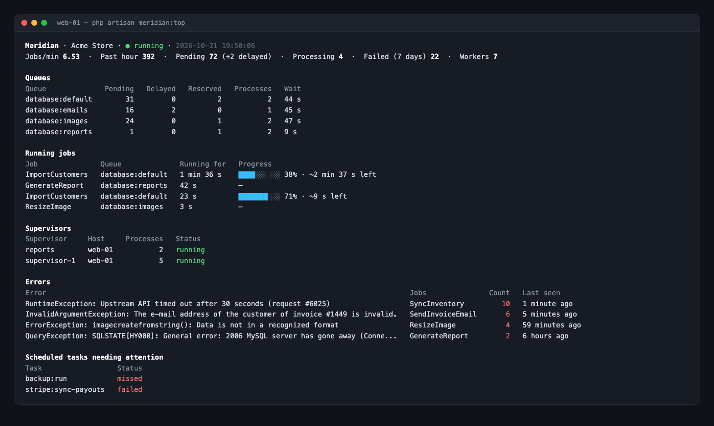

# Pulse, Filament and terminal

**Laravel Pulse**: when Pulse is installed, Meridian registers a `meridian` card with the status, throughput, queues and most frequent errors. Add it to `resources/views/vendor/pulse/dashboard.blade.php`:

```blade
<livewire:meridian cols="4" rows="2" />
```

**Filament** (v4 and v5): register the plugin in your panel to show Meridian's figures and errors on the dashboard and a link to Meridian in the navigation:

```php
use IsoDoss\Meridian\Filament\MeridianPlugin;

$panel->plugin(
    MeridianPlugin::make()
        ->navigationGroup('Monitoring')  // ->navigationLabel(), ->navigationSort(), ->navigationIcon()
        // ->withoutWidgets() or ->withoutNavigation()
);
```

Both only show to the people who can open Meridian.

## In the terminal

`php artisan meridian:top` shows a live view of the queues, the running jobs with their progress, the supervisors, the most frequent errors and the scheduled tasks needing attention, refreshed every two seconds (`--interval=`), for the servers without access to the dashboard. `--once` prints it once, for a script or a CI job.


